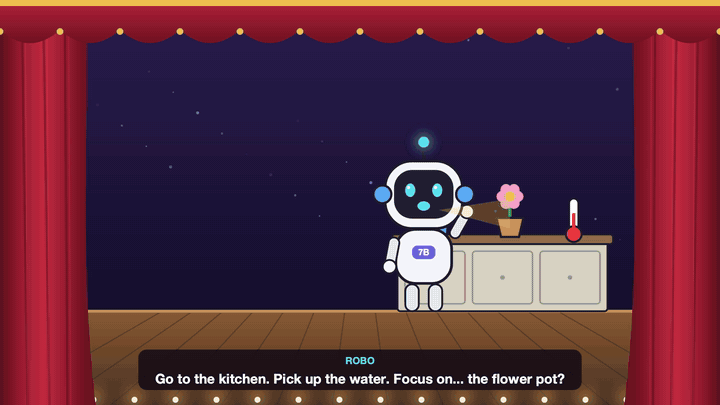
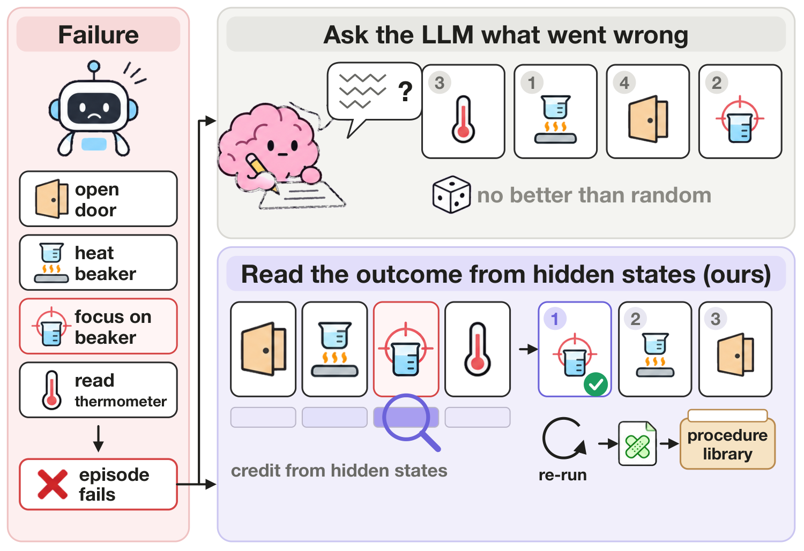
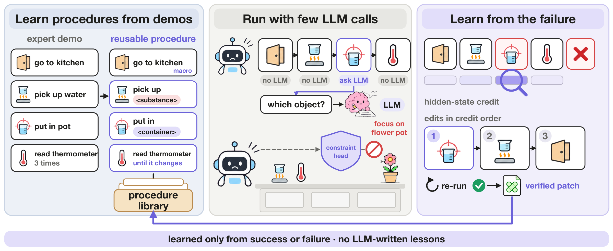
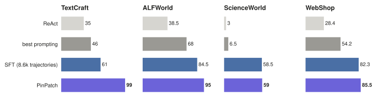
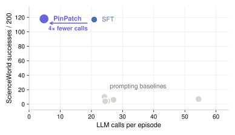
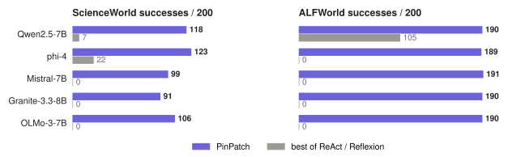

<div align="center">



<h3>Learning from Failure without Self-Diagnosis:<br>Self-Evolving Procedures for LLM Agents</h3>

<p>
<a href="#"></a>
<a href="LICENSE"></a>


<a href="https://github.com/BaiCubed/PinPatch/actions/workflows/smoke.yml"></a>
</p>

<p>
<a href="#-tldr">TL;DR</a> &nbsp;&bull;&nbsp;
<a href="#-how-it-works">How it works</a> &nbsp;&bull;&nbsp;
<a href="#-results">Results</a> &nbsp;&bull;&nbsp;
<a href="#-quick-start">Quick start</a> &nbsp;&bull;&nbsp;
<a href="#-reproducing-the-paper">Reproduce</a> &nbsp;&bull;&nbsp;
<a href="#-citation">Citation</a>
</p>

<a href="https://github.com/BaiCubed/PinPatch/raw/main/assets/pinpatch_play.mp4"></a>

<sub>🎭 <b>PinPatch, a little play</b> (2:46, with voices and <a href="assets/pinpatch_play.srt">subtitles</a>): Robo fails, Professor LLM's diagnosis is no better than random, Detective Pin finds the faulty step, Dr. Patch fixes it, then the real results.</sub>

</div>

https://github.com/user-attachments/assets/b984838e-f46d-4b3d-a0e9-d4d6981567fe

---

## 💡 TL;DR

Small open LLMs fail on long interactive tasks, and self-evolving agents try to learn from those failures by **asking the LLM to diagnose itself**, which a 7B model does no better than chance.
**PinPatch** lets executable procedures do most of the acting, and learns from failure **without any verbal diagnosis**: probes on the frozen policy's hidden states, trained only on whether an episode succeeded, *pin* the step that caused a failure and *patch* the procedure there, keeping a patch only if re-running confirms it.

<p align="center"></p>

<table>
<tr>
<td width="25%" align="center"><b>🧩 Procedures, not prompts</b><br><sub>Demonstrations become executable procedures with slots, loops and a navigation macro. The LLM is asked only to decide, repair or finish.</sub></td>
<td width="25%" align="center"><b>📍 Pin the failure</b><br><sub>A sparse outcome gate on hidden states assigns credit to the step responsible, with no rules and no LLM-written lessons.</sub></td>
<td width="25%" align="center"><b>🩹 Patch, then verify</b><br><sub>Edits are tried in credit order and kept only if they repair the task and break no earlier success.</sub></td>
<td width="25%" align="center"><b>🛡️ Learned guard</b><br><sub>A constraint head on the same hidden state blocks actions predicted to end the episode in failure.</sub></td>
</tr>
</table>

## 🔍 How it works

<p align="center"></p>

1. **Learn procedures from demos.** Expert demonstrations are abstracted into a library of executable procedures.
2. **Run with few LLM calls.** A controller executes the retrieved procedure; most steps need no LLM, and a constraint head on the hidden state blocks fatal actions.
3. **Learn from the failure.** On a failed training episode, outcome-supervised credit points to the responsible step; credit-ordered edits are re-run, validated against earlier successes, and written back to the library.

## 📊 Results

**Same backbone (Qwen2.5-7B-Instruct), AgentGym test splits.** PinPatch beats all thirteen prompting baselines and a model fine-tuned on 8.6k expert trajectories, without training the policy.

<p align="center"></p>
<p align="center"><sub>Success rate (%); WebShop: score. Best prompting = the strongest of 13 prompting, memory, skill and guard methods per environment.</sub></p>

<table>
<tr>
<td width="50%"></td>
<td width="50%">

**⚡ Far fewer LLM calls.** On ScienceWorld PinPatch makes **4.8** LLM calls per episode (4.8k tokens), against 20.9 for the fine-tuned model and 24–54 for prompting baselines. On ALFWorld and WebShop it almost never calls the LLM.

**🧠 Self-diagnosis is no better than random.** Asked to rank candidate repairs for its own failures, the LLM needs 4.23 (Qwen2.5-7B) and 4.45 (phi-4) tries to the first repair, against 4.37 for random order; outcome-supervised credit needs **3.57**.

</td>
</tr>
</table>

**🔁 Holds across five model families**, with every component and hyperparameter fixed:

<p align="center"></p>

## 🚀 Quick start

```bash
git clone https://github.com/BaiCubed/PinPatch.git && cd PinPatch
source scripts/config.sh          # sets PINPATCH_ROOT and PINPATCH_ENVS
bash scripts/setup.sh agentgym    # AgentGym at the pinned commit
bash scripts/setup.sh envs        # Python environments
bash scripts/smoke_textcraft.sh   # CPU, about a minute, no LLM -> SMOKE_OK
```

<details>
<summary><b>📦 Full installation</b></summary>

You need Linux, a CUDA GPU for the LLM (an A40 or larger runs everything), [micromamba](https://mamba.readthedocs.io) on `PATH`, and Java (installed into the env through conda).

```bash
source scripts/config.sh          # sets PINPATCH_ROOT (this directory) and PINPATCH_ENVS (default ./envs)
bash scripts/setup.sh agentgym    # AgentGym at the pinned commit + the ScienceWorld route patch
bash scripts/setup.sh envs        # Python environments: main (vLLM, probes), tc, sci, alf, ma
bash scripts/setup.sh data        # AgentGym test files, ALFWorld 2.1.1 data
bash scripts/setup.sh model       # Qwen2.5-7B-Instruct -> models/
bash scripts/setup.sh link        # shipped artifacts -> runs/ paths the frozen configurations read
```

- **WebShop** uses AgentGym's own server with `num_products=1000`, the 1000-product index in the AgentGym repository. See `scripts/experiments/ws_setup2.sh`, `ws_setup3.sh` and `ws_server.sh`.
- **Third-party code** is not included. Fetch it at these commits:

  | What | Where | Commit | Used for |
  |---|---|---|---|
  | AgentGym | https://github.com/WooooDyy/AgentGym → `code/AgentGym` (`scripts/setup.sh agentgym`) | `3ef9235d23e68e7c2920c5422ad957dc8ced5c6c` | environment servers and clients |
  | ADaPT TextCraft | https://github.com/archiki/ADaPT → `code/pinpatch-textcraft/third_party` (`code/pinpatch-textcraft/setup.sh`) | `ecdc4ab0030b4be9be122622d8ea78f8c59c44c4` | TextCraft environment code imported by the learner |
  | Minecraft 1.16.5 recipes | https://github.com/InventivetalentDev/minecraft-assets (branch 1.16.5) | — | 860 recipe files (same setup script) |
  | MetaAct | https://github.com/BaiCubed/MetaAct → `code/MetaAct` | `d01b2924655aa7fed7be7d025bccfce196a9dafc` | ACE, DC, ReflAct, RPMS, SkillRL, AgentSpec, OntoGuard, MetaAct-synth rows only |

  Only the environment layer of MetaAct is replaced (`code/eval/metaact_ag.py`, whose docstring lists every port adaptation). The AgentSpec rows use the rule sets shipped in that repository (`artifacts/baselines/agentspec_*_rules.json`).
- **SFT baseline**: download AgentGym's AgentTraj-L into `data/AgentTraj-L`.

</details>

<details>
<summary><b>🧪 Smoke test details</b></summary>

```bash
bash scripts/smoke_textcraft.sh   # frozen TextCraft model on 5 test tasks -> SMOKE_OK (5/5 solved)
```

AgentGym's TextCraft builds its crafting tree from the recipe files in `os.listdir` order, so the tree, and with it a few step counts and rarely an outcome, can depend on the filesystem. The paper's TextCraft run solved 99/100. On another machine the same frozen model solved 100/100 (the crossbow task), with step counts differing on a few tasks.

</details>

<details>
<summary><b>▶️ Running anything</b></summary>

Each run needs some of the following:
- **Environment servers**: `bash scripts/env_servers.sh`. ScienceWorld runs on port 36102, ALFWorld on 36103 and WebShop on 36104.
- **A deterministic LLM server**, where the method uses an LLM: `bash scripts/serve_llm.sh GPU PORT [MODEL_DIR]`. This is serial vLLM, the setting used for every number in the paper.

Then run the following from `code/eval` (or from a frozen directory):

```bash
$PINPATCH_ENVS/tc/bin/python run_eval.py --env sciworld --split test --method meta_replay --max-steps 30 \
    --workers 4 --run-id my_run --llm-url http://127.0.0.1:8123/v1
```

Results go to `runs/<run-id>/episodes.jsonl` (one line per task: success, score, steps, actions, LLM calls and tokens) and `summary.json`. Runs can be resumed: finished task ids are skipped.

**Step limits**: TextCraft 40, ALFWorld 30, ScienceWorld 30, WebShop 10. Every primitive environment action counts as a step; macros are expanded.

</details>

## 📁 Repository layout

<details>
<summary><b>Show the layout</b></summary>

```
code/eval/                 controllers, baselines, probes, evolution, analyses (development version, all switches)
  run_eval.py              environment clients; PinPatch controllers: meta_replay (ScienceWorld), meta_alf (ALFWorld),
                           meta_ws (WebShop); ReAct; the LLM client (serial vLLM, temperature 0)
  baselines.py             StateAct, Reflexion, ADaPT, ExpeL on the shared harness
  metaact_ag.py            adapter that runs the MetaAct code release's methods and baselines (ACE, DC, ReflAct, RPMS,
                           SkillRL, AgentSpec, OntoGuard, MetaAct-synth) on our environments, splits and step limits
  lch.py lch_text.py lch2.py   constraint head: label collection, hidden-state features, training, scoring service
  credit.py gate_lambda.py     sparse outcome gate (noisy-OR), sparsity sweep
  repair.py repair_eval.py evolve.py evolve_x.py c3_scale.py   edits, credit orders, budgeted search, patch validation
  ag_run.py                PinPatch on AgentGym TextCraft (uses code/pinpatch-textcraft)
  ws_sim.py ws_fit.py ws_evolve.py ws_head.py alf_evolve.py alf_head.py   WebShop / ALFWorld analyses (appendix)
  sft.py rl_train.py       AgentTraj-L LoRA SFT baseline; RL-at-decision-points analysis
  compare_all.py analysis.py p13_stats.py r5_cost.py r6_attempts.py export_paper_data.py   tables and statistics
  split_*.py sci_demos.py build_alf_prior.py   data splits, ScienceWorld demonstrations, ALFWorld procedures and prior
code/eval_frozen_*/        the exact frozen code behind each test number (see "Frozen configurations")
code/pinpatch-textcraft/   TextCraft learner and planner (lifted effect model)
artifacts/                 learned on TRAIN only: constraint heads (lch/v1.pt, lch/v2e.pt), frozen TextCraft model
data/splits/               every split, the ScienceWorld demonstration pool, the ALFWorld procedures and location prior,
                           the WebShop item scorer
patches/                   one read-only route added to AgentGym's ScienceWorld server (needed only by MetaAct-code baselines)
scripts/                   setup, servers, smoke test, per-table reproduction; scripts/experiments = the scripts we ran
```

</details>

## 🔬 Reproducing the paper

<details open>
<summary><b>Frozen configurations behind every test number</b></summary>

| Environment | Code | Learned files | Command |
|---|---|---|---|
| TextCraft | `code/eval/ag_run.py` + `code/pinpatch-textcraft` | `artifacts/textcraft/merged/model.pkl` | `scripts/reproduce/main_ours.sh` |
| ALFWorld | `code/eval_frozen_alf` (`eval_frozen_alf_m` for other backbones) | `data/splits/alfworld_prior.json` | same |
| ScienceWorld | `code/eval_frozen_c3r2`, `PATCHES=lib_gate_r2.json META_SHIELD=both LCH_TAU=0.9761` | `lib_gate_r2.json`, `artifacts/lch/v1.pt`, `data/splits/sciworld_demos.json` | same |
| WebShop | `code/eval_frozen_ws` | `data/splits/webshop_scorer.json` | same |

</details>

<details>
<summary><b>Which script reproduces which table or figure</b></summary>

The scripts in `scripts/experiments/` are the ones we ran, with server paths replaced by `$PINPATCH_ROOT` / `$PINPATCH_ENVS`. Ports and GPU ids inside them are the ones we used; change them to fit your machine. Each script header states what it runs.

| Paper | What | Scripts |
|---|---|---|
| Table 1, PinPatch | frozen configurations, test once | `scripts/reproduce/main_ours.sh` |
| Table 1, classic baselines | ReAct, StateAct, Reflexion, ADaPT, ExpeL | `experiments/run_baselines.sh PORT test 0 react stateact reflexion adapt expel`; WebShop: `experiments/ws_react_test.sh`; ExpeL with the final prompt placement: `experiments/r3_rerun.sh` |
| Table 1, 2025–26 baselines | ACE, DC, ReflAct; RPMS; AgentSpec + SkillRL; MetaAct-synth; OntoGuard | `experiments/ma_launch1.sh`; `ma_rpms.sh ENV N PORT`; `ma_as_sk.sh` and `as_fix.sh` (published rule sets); `ma_eval.sh` + `ma_synth_test.sh` (+ `ma_rerun.sh`, `ma_sci_fill.sh`); `og_demos*.sh`, `og_kb.sh`, `r3_rerun.sh` |
| Table 1, SFT | LoRA on de-duplicated AgentTraj-L, then ReAct with its training prompt | `code/eval/sft.py prep`, `sft.py train`, then `experiments/p03_eval.sh` |
| Table 1, few-shot / demo ReAct | ReAct with retrieved TRAIN demonstrations | `run_eval.py --method react_fewshot` / `react_demo`; `experiments/r1_run.sh` |
| Cost table | LLM calls and tokens per episode | `code/eval/compare_all.py`, `r5_cost.py` (read `runs/*/episodes.jsonl`) |
| Backbone table | phi-4, Mistral-7B, Granite-3.3-8B, Olmo-3-7B | `experiments/p02_phi4.sh`, `p02_hand.sh`, `p04_family.sh NAME HF_ID GPU PORT`, `a1_backbone.sh` |
| Ablations, τ, demo fraction | module ablations on test; τ and data efficiency on held-out TRAIN | `experiments/abl_pipeline.sh`, `abl_noval.sh`, `abl_stats.py`, `r3_hand_nolib.sh` |
| Constraint head (layers, τ, v2) | labels → features → logistic probe; v2 variants | `experiments/lch_train.sh`, `lch_dev.sh`, `p01_v2.sh`, `p01_v2e.sh`, `p01_test*.sh` |
| Credit / evolution (budget figure) | repairs per failure, credit orders, budgeted search, validated patches, rounds | `experiments/c3_pipeline.sh`, `c3_round2.sh`, `c3_round2b.sh`, `c3_ho2.sh`, `c3_scale.sh`, `c4_pipeline.sh`, `c4_analyze.py`, `rank_eval.sh` |
| Gate sparsity λ; LLM self-diagnosis | λ sweep; LLM-written diagnosis vs gate | `code/eval/gate_lambda.py`; `code/eval/r2a_diag.py`, `experiments/r2a_phi4.sh` |
| Unseen task types | demo pool without the task's type / family | `experiments/p13_patch.py`, `p13_run.sh`, `code/eval/p13_stats.py` |
| WebShop / ALFWorld appendix | verified evolution (P1-1), learned constraint (P1-2) | `experiments/p11_run.sh`, `p12_run.sh`, `p11a_run.sh`, `p12a_run.sh` |
| RL at decision points (appendix) | GRPO on decision points, uniform vs gate credit | `experiments/rl_pipeline.sh`, `rl_pipeline2.sh`, `rl_fp.sh`, `rl_heldout.sh` |
| Replay verification | every success replayed in a fresh environment | `code/eval/verify_replay.py`, `verify_sci_replay.py`, `verify_tc_replay.py` |

</details>

<details>
<summary><b>Determinism</b></summary>

- All test runs use a serial vLLM server: one request at a time, no prefix caching, seed 0, temperature 0. They also set `PYTHONHASHSEED=0`.
- Identical inputs give identical outputs on the same server and library versions.
- Test splits are never used for selection; every choice was made on TRAIN or held-out TRAIN.

</details>

## 📝 Citation

```bibtex
@article{pinpatch2026,
  title   = {Learning from Failure without Self-Diagnosis: Self-Evolving Procedures for LLM Agents},
  author  = {Authors to be added},
  journal = {arXiv preprint},
  year    = {2026}
}
```

## 🙏 Acknowledgements

PinPatch builds on [AgentGym](https://github.com/WooooDyy/AgentGym) and its versions of [ALFWorld](https://github.com/alfworld/alfworld), [ScienceWorld](https://github.com/allenai/ScienceWorld), [WebShop](https://github.com/princeton-nlp/WebShop) and TextCraft (from [ADaPT](https://github.com/archiki/ADaPT)). The 2025–26 baselines run through the [MetaAct](https://github.com/BaiCubed/MetaAct) code release.

## ⚖️ License

MIT (see [`LICENSE`](LICENSE)). AgentGym, ALFWorld, ScienceWorld, WebShop, the MetaAct code release and the models keep their own licenses.
